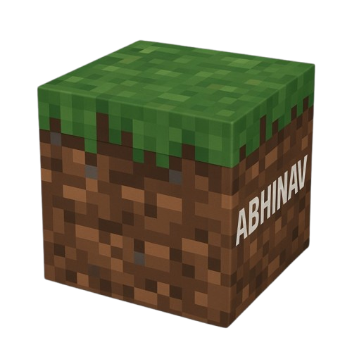
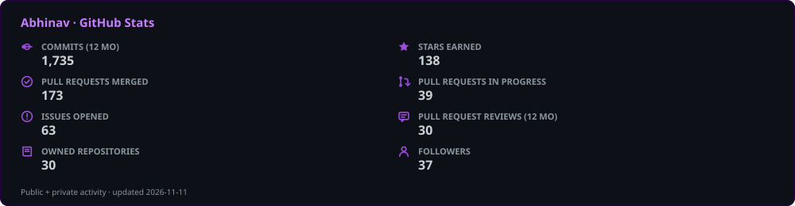
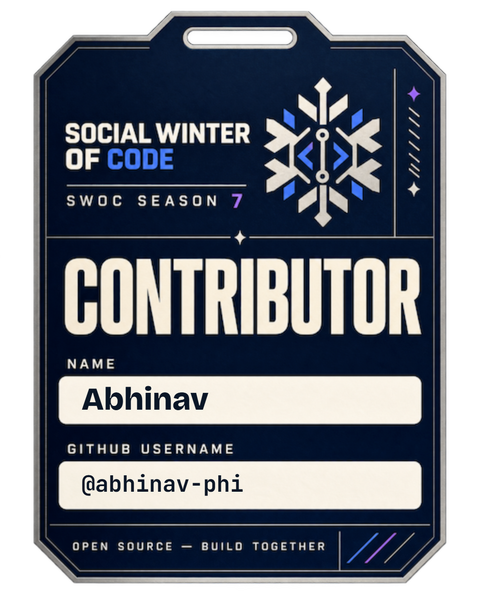
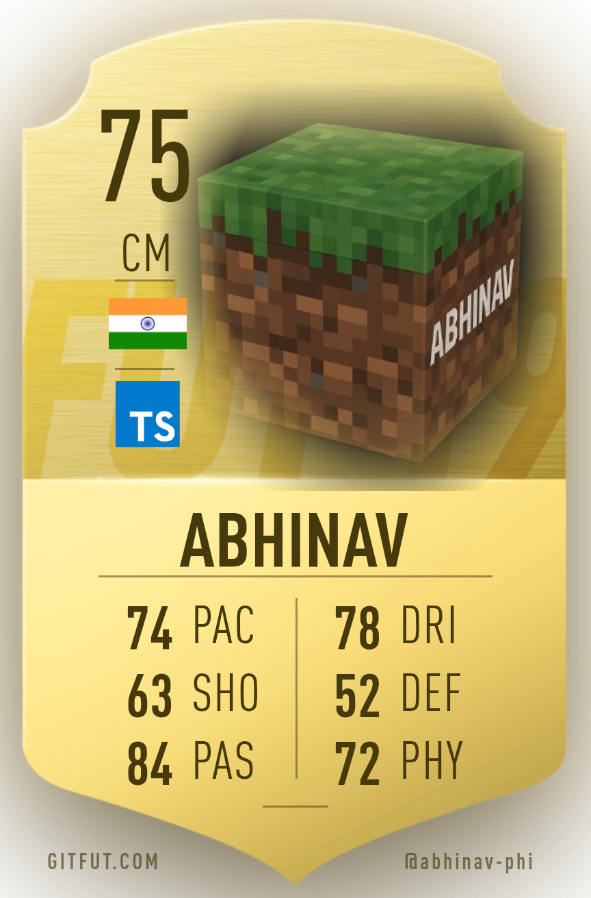

 

<h1 align="center">Hi, I'm Abhinav! 👋</h1>
<h3 align="center">3rd yr UnderGrad | Full-Stack & AI/ML Enthusiast</h3>

 

## GitHub Analytics

 
 

## Open Source — Major Organizations

| Organization | Flagship | Contributions | PRs merged | PRs open | Issues | Repos |
|:---|:---|---:|---:|---:|---:|---:|
| [apache](https://github.com/apache) | [superset](https://github.com/apache/superset) 75.4k★ | **41** | 26 | 12 | 3 | 13 |
| [kubernetes](https://github.com/kubernetes) | [kubernetes](https://github.com/kubernetes/kubernetes) 128.8k★ | **11** | 6 | 5 | | 3 |
| [OWASP](https://github.com/OWASP) | [CheatSheetSeries](https://github.com/OWASP/CheatSheetSeries) 33.8k★ | **5** | 2 | 3 | | 4 |
| [python](https://github.com/python) | [cpython](https://github.com/python/cpython) 77.8k★ | **2** | | 2 | | 1 |
| [qdrant](https://github.com/qdrant) | [qdrant](https://github.com/qdrant/qdrant) 35.4k★ | **2** | | 1 | 1 | 1 |
| [ceph](https://github.com/ceph) | [ceph](https://github.com/ceph/ceph) 17.2k★ | **2** | 2 | | | 1 |
| [openvinotoolkit](https://github.com/openvinotoolkit) | [openvino](https://github.com/openvinotoolkit/openvino) 11.1k★ | **2** | 2 | | | 1 |
| [checkstyle](https://github.com/checkstyle) | [checkstyle](https://github.com/checkstyle/checkstyle) 9.6k★ | **2** | 1 | | 1 | 1 |
| [huggingface](https://github.com/huggingface) | [transformers](https://github.com/huggingface/transformers) 168.4k★ | **1** | 1 | | | 1 |
| [JetBrains](https://github.com/JetBrains) | [kotlin](https://github.com/JetBrains/kotlin) 53.5k★ | **1** | | 1 | | 1 |
| [llvm](https://github.com/llvm) | [llvm-project](https://github.com/llvm/llvm-project) 41.3k★ | **1** | 1 | | | 1 |
| [refinedev](https://github.com/refinedev) | [refine](https://github.com/refinedev/refine) 36k★ | **1** | | 1 | | 1 |
| [kestra-io](https://github.com/kestra-io) | [kestra](https://github.com/kestra-io/kestra) 30.1k★ | **1** | 1 | | | 1 |
| [envoyproxy](https://github.com/envoyproxy) | [envoy](https://github.com/envoyproxy/envoy) 29.2k★ | **1** | 1 | | | 1 |
| [jenkinsci](https://github.com/jenkinsci) | [jenkins](https://github.com/jenkinsci/jenkins) 26.7k★ | **1** | | 1 | | 1 |
| [kubernetes-sigs](https://github.com/kubernetes-sigs) | [kubespray](https://github.com/kubernetes-sigs/kubespray) 18.8k★ | **1** | | 1 | | 1 |
| [vitest-dev](https://github.com/vitest-dev) | [vitest](https://github.com/vitest-dev/vitest) 17.3k★ | **1** | 1 | | | 1 |
| [weaviate](https://github.com/weaviate) | [weaviate](https://github.com/weaviate/weaviate) 16.9k★ | **1** | | 1 | | 1 |
| [ArduPilot](https://github.com/ArduPilot) | [ardupilot](https://github.com/ArduPilot/ardupilot) 16.3k★ | **1** | | 1 | | 1 |
| [sympy](https://github.com/sympy) | [sympy](https://github.com/sympy/sympy) 15.1k★ | **1** | | 1 | | 1 |
| [oppia](https://github.com/oppia) | [oppia](https://github.com/oppia/oppia) 7k★ | **1** | 1 | | | 1 |
| [robolectric](https://github.com/robolectric) | [robolectric](https://github.com/robolectric/robolectric) 6.1k★ | **1** | | 1 | | 1 |
| **22 organizations** | | **81** | **45** | **31** | **5** | **39** |

**How to read this.** *Contributions* = PRs merged + PRs open + issues opened, pulled live from the GitHub Search API on **2026-11-01**. Only organizations whose flagship repository has **5,000+ stars** are listed — smaller projects are left out. An empty cell means zero.

### Own repositories

| Account | Contributions | PRs merged | Issues | Repos |
|:---|---:|---:|---:|---:|
| [abhinav-phi](https://github.com/abhinav-phi) | **148** | 91 | 57 | 11 |

## Tech Stack

**Languages**

**Frontend**

**Backend & Databases**

**ML & DevOps**

 

<picture>
  <source media="(prefers-color-scheme: dark)" srcset="https://raw.githubusercontent.com/abhinav-phi/abhinav-phi/output/github-contribution-grid-snake-dark.svg" />
  <source media="(prefers-color-scheme: light)" srcset="https://raw.githubusercontent.com/abhinav-phi/abhinav-phi/output/github-contribution-grid-snake.svg" />
  
</picture>

